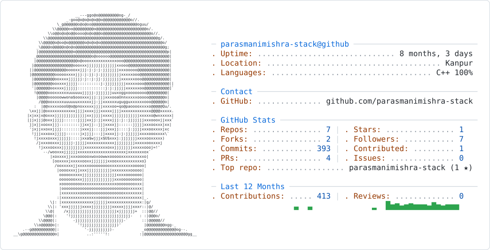

<picture>
  <source media="(prefers-color-scheme: dark)" srcset="./dark_mode.svg">
  <source media="(prefers-color-scheme: light)" srcset="./light_mode.svg">
  
</picture>
 

---

# Paras Mani Mishra

<code>@parasmanimishra-stack</code> · B.Tech CSE Student · DSA · AI/ML

  
  
  

  
  

**[📖 Overview](#-overview) · [🧰 Toolbox](#-toolbox) · [📌 Projects](#-projects) · [🌱 Activity](#-github-activity) · [🤝 Connect](#-lets-connect)**

---

## 📖 Overview

### Hey there, I'm Paras! 👋

> *"Learn consistently. Build patiently. Improve every day."*

I'm a **B.Tech Computer Science Engineering student** interested in problem-solving, software development, and Artificial Intelligence.

I regularly practice **Data Structures and Algorithms in C++** to improve my logical thinking. I'm also exploring Python, SQL, AI/ML, and open-source contribution while building my technical foundation.

<table>
<tr>
<td width="50%" valign="top">

### 🔭 What I'm working on

- 🧩 Practising DSA and problem-solving
- 💻 Improving my C++ and programming fundamentals
- 🤖 Exploring AI/ML and practical project ideas
- 🌱 Learning Git, GitHub, and open-source workflows
- 🚀 Preparing for hackathons and coding contests

</td>
<td width="50%" valign="top">

### 🎯 Current goals

- Strengthen DSA and problem-solving patterns
- Build useful beginner-friendly projects
- Learn machine learning step by step
- Make my first meaningful open-source contributions
- Improve my technical and communication skills

</td>
</tr>
</table>

---

## 🧰 Toolbox

**Languages**

**Tools & Platforms**

**Areas I'm learning**

---

## 📌 Projects

<table>
<tr>
<td width="50%" valign="top">

### 🚦 [Train Traffic Control](https://github.com/vin-ydv/train_traffic_control)

A hackathon project focused on train traffic management, train prioritisation, and presenting useful operational information through a dashboard.

**Focus:** Frontend · Dashboard · Hackathon

</td>
<td width="50%" valign="top">

### 🤖 AI Smart Study Planner

A student-focused AI/ML project concept designed to help learners organise their study tasks, plan their time, and manage their learning goals.

**Focus:** AI/ML · Productivity · Student tools

*Status: Planned / in progress — update this when your implementation progresses.*

</td>
</tr>
</table>

---

## 📊 GitHub Activity

  

### 🌱 Keep up with my activity

- [My repositories](https://github.com/parasmanimishra-stack?tab=repositories)
- [My commits](https://github.com/parasmanimishra-stack?tab=overview)
- [My contributions](https://github.com/parasmanimishra-stack)
- [My starred projects](https://github.com/parasmanimishra-stack?tab=stars)

---

## 🌱 Beyond the code

- ♟️ Chess — strategy and decision-making
- 🏸 Badminton — staying active
- ⚽ Football — teamwork and energy
- 🧠 Continuous learning — one concept at a time

---

## 🤝 Let's connect

I'm learning, experimenting, and working towards becoming a stronger software developer and AI engineer.

  

Made with curiosity, consistency, and ☕ · Keep learning, keep building.

